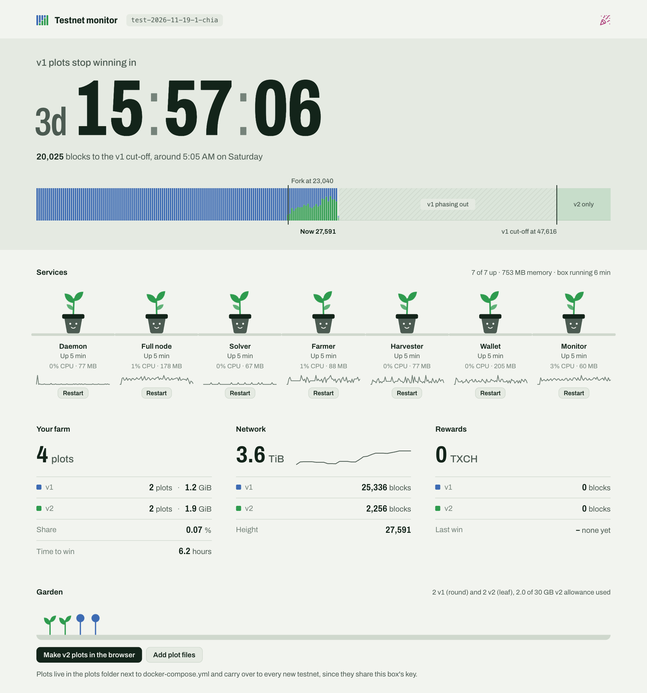
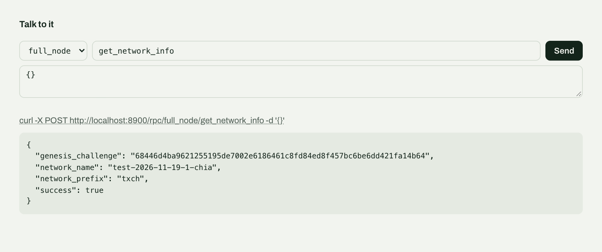
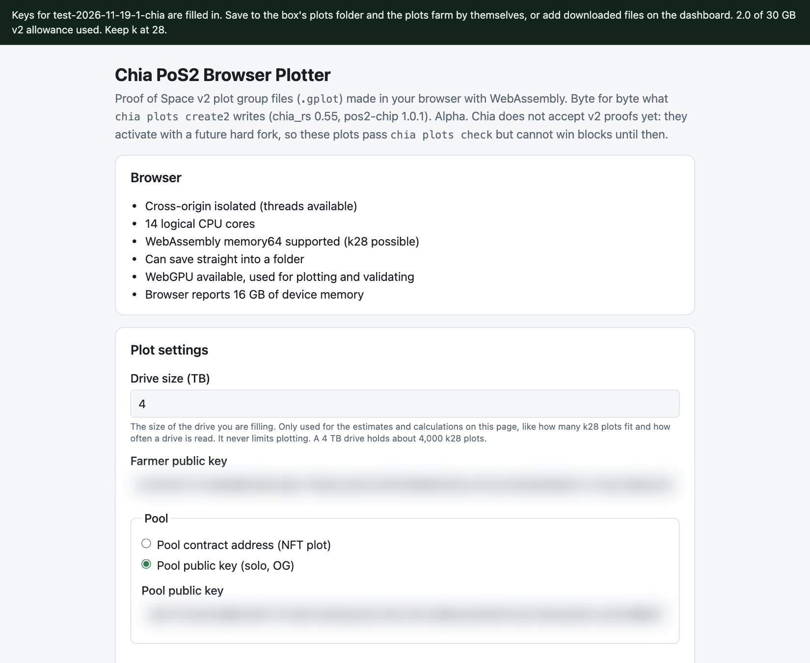

# Chia ephemeral testnet in Docker

A Chia ephemeral PoS2 testnet in one container: node, farmer, harvester, wallet and solver, with a dashboard, a v2
plotter that runs in your browser, and an RPC gateway, all on one port. The current testnet's config is included, so
there is nothing to set up.

<picture>
  <source media="(prefers-color-scheme: dark)" srcset="docs/dashboard-dark.png">
  
</picture>

## Quick start

You need Git and Docker with Compose.

```sh
git clone https://github.com/judeallred/chia-dockerized-ephemeral-testnet
cd chia-dockerized-ephemeral-testnet
./testnet up
```

Then open http://localhost:8900. Without bash, use `docker compose up -d --build` instead of `./testnet up`.

The first build takes a few minutes. The box then makes a key, finds peers and syncs the node (about 10 minutes for
27,000 blocks). Once it is synced it makes two small v1 plots and, if the container has
enough memory, two v2 plots, and starts farming. You can also make v2 plots in your browser (see [Plots](#plots)). `./testnet down` stops it and keeps
your key, plots and chain data. `./testnet help` lists the other commands.

## When a new testnet launches

The bundled config is [`default/initial-config.zip`](default/initial-config.zip), currently for
`test-2026-11-19-1-chia`. Ephemeral testnets are replaced often, so it goes out of date. If your node finds no peers or
stops getting blocks, get the latest `initial-config.zip` from the testnet Discord channel and do one of these:

- drop it anywhere on the dashboard
- run `./testnet up path/to/initial-config.zip`
- put it in `./config`

The box switches within seconds. Your key and plots carry over, and chain data is kept per network.
If the testnet also needs newer code, run `./testnet update` afterwards.

Which config is used:

- The newest `.zip` or `.yaml` in `./config` always wins.
- The bundled one is used only while `./config` has none. Emptying `./config` does not move a running box. To go back to
  the bundled testnet, empty it and run `./testnet down`, then `./testnet up`.
- To get a newer bundled config, run `git pull` and `./testnet up`, with no config in `./config`.

To update the bundled config in this repository, replace `default/initial-config.zip` and the network name above.

## What is on the port

| Path | What |
| --- | --- |
| `/` | Dashboard: [chia-testnet-monitor](https://github.com/greimela/chia-testnet-monitor), cloned at build time and unmodified, plus this box's services, plots, RPC console and log |
| `/plotter/` | Browser plotter for v2 plots: [chia-plotter-wasm](https://github.com/judeallred/chia-plotter-wasm), cloned and built into the image |
| `/rpc/<service>/<endpoint>` | Chia RPC without certificates: `full_node`, `wallet`, `farmer`, `harvester`, `solver` |
| `/api/state`, `/api/box` | The dashboard's data as JSON |
| `/api/plots/<name>` | `PUT` a finished plot file |
| `/api/config` | `PUT` a new `initial-config.zip` or `.yaml` |
| `/metrics`, `/healthz` | Prometheus metrics, health check |

```sh
curl localhost:8900/rpc/full_node/get_blockchain_state
curl -X POST localhost:8900/rpc/wallet/get_wallet_balance -d '{"wallet_id": 1}'
```

The dashboard has a console for the same calls:



`GET` works for `get_*` endpoints; everything else is `POST`. Port 58445 is the Chia peer protocol, so a
light wallet on your machine can use the node.

## Plots

Plots go in `./plots`, which the harvester scans every 30 seconds.

- **v1, automatic**: two k25 plots (about 0.7 GB each). `AUTO_V1_PLOTS=0` turns that off, `./testnet box plot-v1 5` makes
  more. v1 plots stop farming at the v1 cut-off shown on the dashboard.
- **v2, automatic**: two k28 plots (about 1 GB each), one at a time on the CPU, at low priority. This only happens when the
  container has 11 GB of free memory; otherwise the dashboard says why and the other ways below still work. On a Mac that
  means giving Docker Desktop about 16 GB. `AUTO_V2_PLOTS=0` turns it off. Plots you add yourself count towards the two.
- **v2 in the browser**: the bundled [chia-plotter-wasm](https://github.com/judeallred/chia-plotter-wasm) is at `/plotter/`,
  with nothing to install. Open it in Chrome or Edge on the same machine. This box's keys are filled in. Keep k at 28
  and choose the `plots` folder as the output. A k28 plot is about 1 GB and needs about 11 GB of free memory while it
  is made, so close other things first. It can use your GPU through WebGPU, even on a Mac, where the container can't.
  In other browsers, download the plot and add it on the dashboard.
- **v2 with cpos or xchplot2**: use the farmer and pool public keys from the dashboard and write to `./plots`.
- **v2 in the container, by hand**: `./testnet box plot-v2 2`. Same memory needs as the automatic ones.



v2 plots must be k28. Other sizes don't count on this testnet.

The testnet asks for at most 30 GB of v2 plots per person. The box enforces that for uploads and
`plot-v2`; it can't for other plotters, so the dashboard warns instead.

## Keys

A new key is made on first start and kept in the `data` volume. To use your own **testnet** key, mount a
file with its mnemonic at `/run/secrets/mnemonic` before the first start. Never use a mainnet key.
`./testnet box mnemonic` shows the words.

## Safety

The gateway can spend from the testnet wallet, so compose publishes it on 127.0.0.1 only. It refuses
unknown `Host` headers and cross-origin browser requests, and blocks endpoints that reveal or delete keys
or delete plots. Mainnet configs are refused. To reach it from elsewhere, set `API_TOKEN` and `ALLOWED_HOSTS`, and
put TLS in front.

| Variable | Default | |
| --- | --- | --- |
| `BOX_PORT` / `P2P_PORT` | 8900 / 58445 | Host ports |
| `AUTO_V1_PLOTS` | 2 | Starter v1 plots |
| `AUTO_V2_PLOTS` | 2 | Starter v2 plots, if there is enough memory |
| `CHIA_REF` | hardfork-testnet | chia-blockchain branch |
| `API_TOKEN` | | Bearer token for RPC, uploads and restarts |
| `ALLOWED_HOSTS` | localhost and friends | Accepted `Host` names |
| `CORS_ORIGINS` | | Other web origins allowed to call the API, e.g. `http://localhost:3000` |
| `UNSAFE_RPC` | | `1` allows the blocked endpoints |

Put them in `.env`.

## Good to know

- The node may log `failed fetching 0 to 31 from peers` and restart its sync a few times at first. That
  happens when a block arrives while the weight proof is checked. It retries until it gets through.
- On this branch the farmer doesn't connect to the solver by itself; the box does it, and again after restarts.
- Docker networks usually have no IPv6, so connections to IPv6 peers and `IN AAAA` lookups fail in the log. That is
  harmless.
- Newer harvesters describe v2 plots in a way chia-testnet-monitor doesn't read yet, and it stops updating once you have
  one. `app/run_monitor.py` runs it unmodified and translates that one answer.
- The wallet only talks to the node in the container, so it syncs after the node does.
- `./testnet up` reuses the code Docker already downloaded, which can be older than what `./testnet update` fetched. After
  an `up`, run `./testnet update` again if you need the newest.
- Old networks' data: `./testnet box prune`.

## License

Apache 2.0, see [LICENSE](LICENSE). The image also contains chia-blockchain, chia-testnet-monitor and
chia-plotter-wasm, each under its own Apache 2.0 license.
